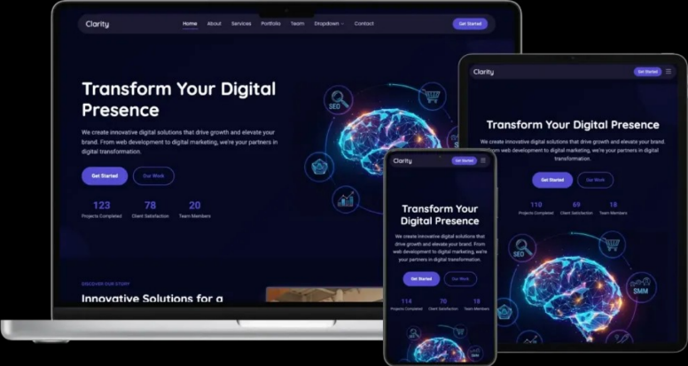

# Clarity – Digital Agency Website

A responsive one-page website for a fictional digital agency called **Clarity**, built with **Bootstrap 5** as a course project. It follows a dark navy and indigo theme and works on phones, tablets and desktops.

**Live demo:** https://KhlouddAhmed.github.io/Clarity-Digital-Agency/

---

## Preview



---

## Features

- **Navbar** with logo, links, a dropdown menu and a "Get Started" button. It collapses into a hamburger menu on small screens.
- **Hero section** with a heading, short text, two buttons and an image that moves under the text on phones.
- **Statistics** under the hero (projects, satisfaction, team members).
- **About** section in two columns with photos.
- **Services**: 6 cards, 3 per row on desktop, 2 on tablet and 1 on phone.
- **Portfolio**: 6 project cards with category, rating and technology badges.
- **Why Us**: feature cards and a short list of reasons.
- **Testimonials**: a Bootstrap carousel (3 cards at a time on desktop, 1 on phone).
- **Team**: shaped team photos, a leadership carousel and a "Join Our Mission" card.
- **Contact**: contact details and a form with name, email, subject, message and a submit button.
- **Footer** with company info, quick links, social icons and copyright.
- Active menu link while scrolling (Bootstrap scrollspy) and smooth scrolling.
- A back-to-top button.

## Built With

- HTML5 (semantic tags: `header`, `nav`, `main`, `section`, `footer`)
- CSS3 (one short custom file, `css/style.css`)
- [Bootstrap 5.3.8](https://getbootstrap.com/) (grid, navbar, dropdown, cards, forms, carousel, badges, utilities)
- [Bootstrap Icons](https://icons.getbootstrap.com/)
- [Google Fonts](https://fonts.google.com/) (Quicksand, Poppins, Roboto)

No custom JavaScript is used. Only the Bootstrap bundle from the CDN powers the navbar menu, dropdown and carousels.

## Project Structure

```
Clarity-Digital-Agency/
├── index.html
├── css/
│   └── style.css
├── images/
│   ├── all-screens.png      (preview screenshot used in this README)
│   └── ...                  (site photos)
└── README.md
```

## Responsive Behaviour

| Device  | Width        | What changes                                              |
| ------- | ------------ | --------------------------------------------------------- |
| Phone   | about 375px  | Hamburger menu, one column, hero image under the text     |
| Tablet  | about 768px  | Two cards per row in Services and Portfolio               |
| Desktop | 1200px and up | Full navbar, three cards per row, side-by-side layouts   |

## Run It Locally

1. Clone the repository:
   ```bash
   git clone https://github.com/KhlouddAhmed/Clarity-Digital-Agency.git
   ```
2. Open the folder and double-click `index.html` (or use the Live Server extension in VS Code).
3. You need an internet connection, because Bootstrap, the icons and the fonts load from a CDN.

## Deploy With GitHub Pages

1. Open the repository on GitHub and go to **Settings → Pages**.
2. Under **Source**, choose **Deploy from a branch**.
3. Select the `main` branch and the `/ (root)` folder, then click **Save**.
4. After a minute, your site is live at `https://KhlouddAhmed.github.io/Clarity-Digital-Agency/`.

## Credits

- Layout inspired by the Clarity template reference design from [BootstrapMade](https://bootstrapmade.com/content/demo/Clarity/). All code and text in this project were written by me.
- Photos from [Unsplash](https://unsplash.com/) / [Pexels](https://www.pexels.com/). Replace this line with the photographers or the source you used.

## Author

**Khloud Ahmed**
Course: Bootstrap | GDG on Campus, Canadian International College
GitHub: [@KhlouddAhmed](https://github.com/KhlouddAhmed)